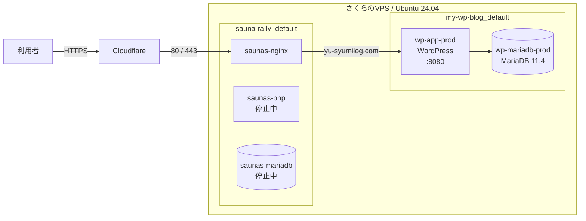

# 00 概要

[目次へ戻る](README.md)

## 運用サイト

| サイト | 内容 | 状態 |
| --- | --- | --- |
| yu-syumilog.com | 技術ブログ（WordPress） | 稼働中 |
| sauna-rally.com | 自作Webサービス | サービス終了ページのみ表示 |

## 全体構成

- 利用者からの通信はすべて Cloudflare を経由する
- 80/443 番は `saunas-nginx` が受け、両ドメインの入口を担当する
- yu-syumilog.com へのリクエストは `wp-app-prod`（ホストの 8080 番）へ転送する
- sauna-rally.com は Nginx がサービス終了ページを返す

## 関連リポジトリ

| リポジトリ | 内容 |
| --- | --- |
| [my-wp-blog](https://github.com/yu-corder/my-wp-blog) | WordPress の compose 定義、子テーマ、翻訳ファイル、deploy.sh |
